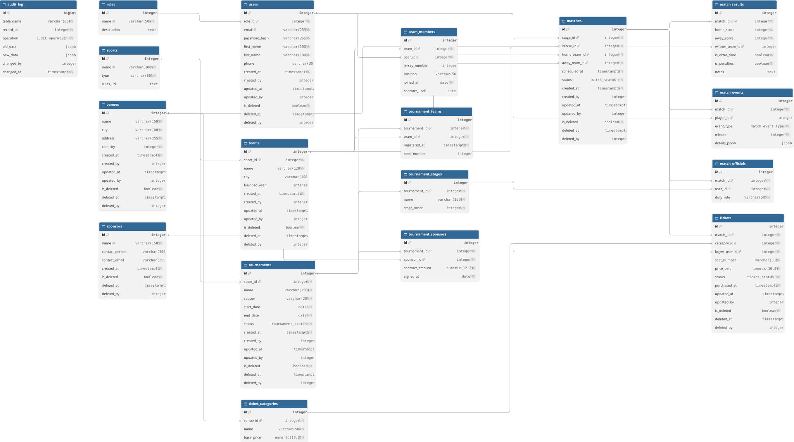

# Система управління спортивними подіями



## Мета

База даних призначена для організації та проведення спортивних турнірів і матчів. Вона дозволяє в одному місці:

- вести довідники видів спорту, команд, гравців, спортивних арен, спонсорів і суддів;
- організовувати турніри за сезонами, розбивати їх на етапи та реєструвати команди-учасниці;
- планувати розклад матчів на аренах, призначати суддів, фіксувати ігрові події (голи, картки, заміни) та підсумкові результати;
- продавати квитки глядачам за категоріями місць із контролем вільних місць на арені;
- автоматично формувати турнірну таблицю (очки, перемоги, нічиї, різниця м'ячів);
- зберігати історію змін: хто, коли і що змінив (`updated_at`, `updated_by`, `audit_log`), а видалені записи не втрачати фізично (`Soft Delete`).

## Технології

- PostgreSQL 16 (Docker)
- Node.js + TypeScript
- `pg` (node-postgres)

## Таблиці та зв'язки (18 сутностей)

Таблиці з підтримкою **Soft Delete** (`is_deleted`, `deleted_at`, `deleted_by`): `users`, `venues`, `sponsors`, `teams`, `tournaments`, `matches`, `tickets`.

Поля **дати останньої зміни та користувача, що їх змінив** (`updated_at` / `updated_by`, а також `created_at` / `created_by`), мають: `users`, `venues`, `teams`, `tournaments`, `matches`, `tickets`. Усі поля `*_by` посилаються на `users(id)`.

### Користувачі та ролі

| Таблиця | Призначення | Зв'язки |
|---|---|---|
| `roles` | ролі користувачів (`admin`, `organizer`, `referee`, `player`, `fan`) | 1 → N `users` |
| `users` | користувачі системи | N → 1 `roles`; 1 → N `team_members`, `match_officials`, `tickets` |

### Довідники та арени

| Таблиця | Призначення | Зв'язки |
|---|---|---|
| `sports` | види спорту (командні / індивідуальні) | 1 → N `teams`, `tournaments` |
| `venues` | спортивні арени / стадіони з місткістю | 1 → N `ticket_categories`, `matches` |
| `ticket_categories` | категорії місць на арені (Standard, VIP) з базовою ціною | N → 1 `venues`; 1 → N `tickets` |
| `sponsors` | спонсори змагань | 1 → N `tournament_sponsors` |

### Команди

| Таблиця | Призначення | Зв'язки |
|---|---|---|
| `teams` | спортивні команди | N → 1 `sports`; 1 → N `team_members`, `tournament_teams`, `matches` |
| `team_members` | склад команди: гравці, ігрові номери, позиції, контракти | N → 1 `teams`, N → 1 `users` |

### Турніри

| Таблиця | Призначення | Зв'язки |
|---|---|---|
| `tournaments` | турніри за сезонами зі статусом життєвого циклу | N → 1 `sports`; 1 → N `tournament_stages`, `tournament_teams`, `tournament_sponsors` |
| `tournament_stages` | етапи турніру (груповий етап, чвертьфінал, фінал) | N → 1 `tournaments`; 1 → N `matches` |
| `tournament_teams` | реєстрація команд у турнірі (зв'язок N ↔ M) | N → 1 `tournaments`, N → 1 `teams` |
| `tournament_sponsors` | спонсорські контракти турнірів (зв'язок N ↔ M) | N → 1 `tournaments`, N → 1 `sponsors` |

### Матчі та квитки

| Таблиця | Призначення | Зв'язки |
|---|---|---|
| `matches` | матчі між домашньою та гостьовою командами на арені | N → 1 `tournament_stages`, `venues`, `teams` (`home_team_id`, `away_team_id`); 1 → 1 `match_results`; 1 → N `match_events`, `match_officials`, `tickets` |
| `match_results` | підсумковий рахунок і переможець матчу | 1 → 1 `matches` (`UNIQUE match_id`), N → 1 `teams` (`winner_team_id`) |
| `match_events` | хронологія подій матчу (голи, картки, заміни) з деталями в `JSONB` | N → 1 `matches`, N → 1 `users` (`player_id`) |
| `match_officials` | судді, призначені на матч | N → 1 `matches`, N → 1 `users` |
| `tickets` | квитки глядачів на матч із номером місця та статусом | N → 1 `matches`, `ticket_categories`, `users` (`buyer_user_id`) |

### Аудит

| Таблиця | Призначення | Зв'язки |
|---|---|---|
| `audit_log` | журнал змін зі старими й новими значеннями в `JSONB` | N → 1 `users` (`changed_by`) |

---

## Вимоги до системи

### Користувачі, аудит та Soft Delete
- Кожен користувач має роль (`admin`, `organizer`, `referee`, `player`, `fan`).
- Основні сутності (`users`, `venues`, `sponsors`, `teams`, `tournaments`, `matches`, `tickets`) підтримують **м'яке видалення (Soft Delete)**: запис позначається прапорцем `is_deleted = true`, фіксується час видалення `deleted_at` та користувач `deleted_by`. Видалені записи можна відновити.
- При кожному оновленні записів автоматично тригером заповнюються `updated_at` (час зміни) та `updated_by` (користувач, що змінив дані).
- Зміни основних таблиць автоматично логуються тригером у таблицю `audit_log` у форматі `JSONB` (включно з операціями `SOFT_DELETE` та `RESTORE`).

### Команди та турніри
- Назва команди є унікальною серед активних (не видалених) команд одного виду спорту.
- Команду не можна м'яко видалити, якщо вона бере участь в активному турнірі (`status = 'ongoing'`).
- Турнір має дати початку й завершення (`end_date >= start_date`), складається з послідовних етапів (`tournament_stages`) та об'єднує зареєстровані команди (`tournament_teams`).

### Матчі, результати та квитки
- У матчі домашня та гостьова команди не можуть збігатися (`home_team_id <> away_team_id`).
- Результат матчу (`match_results`) автоматично визначає переможця за рахунком і переводить матч у статус `completed`.
- На основі завершених матчів розраховується турнірна таблиця: 3 очки за перемогу, 1 за нічию, 0 за поразку.
- Під час продажу квитка тригер перевіряє, що категорія місця належить арені матчу і що на стадіоні є вільні місця. Одне місце на матч може бути продане лише один раз серед активних квитків.

---

## Об'єкти БД (п.5 та п.6)

### Користувацькі функції (`sql/02_functions.sql` — 3 шт.)
1. `fn_current_app_user()` — повертає ID поточного користувача сесії (`app.user_id`).
2. `fn_match_available_seats(p_match_id)` — обчислює кількість вільних місць на арені матчу.
3. `fn_tournament_standings(p_tournament_id)` — формує турнірну таблицю (ігри, В/Н/П, м'ячі, очки, позиція).

### Тригери (`sql/03_triggers.sql` — 3 тригерні функції)
1. `trg_fn_set_updated()` — автоматично виставляє `updated_at = now()` та `updated_by = fn_current_app_user()` при `UPDATE`.
2. `trg_fn_audit_log()` — записує старі та нові значення запису в `audit_log` (розпізнає `INSERT`, `UPDATE`, `SOFT_DELETE`, `RESTORE`).
3. `trg_fn_ticket_check()` — перевіряє перед продажем квитка відповідність категорії арені та наявність вільних місць.

### Розрізи даних (`sql/04_views.sql` — 5 шт.)
1. `v_teams` — активні (не видалені) команди.
2. `v_tournaments` — активні турніри з підрахунком зареєстрованих команд.
3. `v_match_schedule` — розклад активних матчів із рахунком і кількістю вільних місць.
4. `v_tickets` — активні квитки з даними матчу та покупця.
5. `v_tournament_standings` — турнірна таблиця всіх активних турнірів.

### Збережені процедури (`sql/05_procedures.sql` — 9 шт.)
1. `sp_team_create` — створення команди.
2. `sp_team_update` — оновлення команди.
3. `sp_team_soft_delete` — м'яке видалення команди (з перевіркою участі в активному турнірі).
4. `sp_team_restore` — відновлення видаленої команди.
5. `sp_tournament_create` — створення турніру разом із першим етапом.
6. `sp_tournament_register_team` — реєстрація команди в турнірі.
7. `sp_match_schedule` — планування матчу.
8. `sp_match_record_result` — запис рахунку матчу та завершення гри.
9. `sp_ticket_sell` — продаж квитка на матч.

### Індекси (`sql/06_indexes.sql` — 6 індексів 2 типів: B-tree та GIN)
- **B-tree (часткові унікальні та складені):** `uq_tickets_active_seat`, `uq_teams_active_name`, `ix_matches_stage_scheduled`, `ix_audit_log_table_record`.
- **GIN (для JSONB):** `gx_match_events_details` (`match_events.details_jsonb`), `gx_audit_log_new_data` (`audit_log.new_data`).

---

## Запуск

```bash
docker compose up -d
npm install
npm run db:install
npm run demo
```

*(У PowerShell за потреби використовуйте `npm.cmd` замість `npm`).*
Для повторного запуску демо спочатку виконайте `npm run db:install`, щоб перевстановити початкові дані.

## Структура проєкту

| Файл | Вміст |
|---|---|
| `sql/00_installation.sql` | головний скрипт встановлення |
| `sql/01_schema.sql` | 18 таблиць, ENUM-типи, ключі та обмеження |
| `sql/02_functions.sql` | 3 користувацькі функції (`plpgsql`) |
| `sql/03_triggers.sql` | 3 тригерні функції (аудит, `updated_at`/`updated_by`, перевірка квитків) |
| `sql/04_views.sql` | 5 розрізів даних (`v_*`) |
| `sql/05_procedures.sql` | 9 збережених процедур (`sp_*`) |
| `sql/06_indexes.sql` | 6 індексів двох типів (`B-tree`, `GIN`) |
| `sql/07_seed.sql` | початкові тестові дані |
| `src/` | комбінація патернів `Repository + Unit of Work` на TypeScript |
| `diagram/` | схема БД у форматі DBML (`schema.dbml`) для `dbdiagram.io` |
